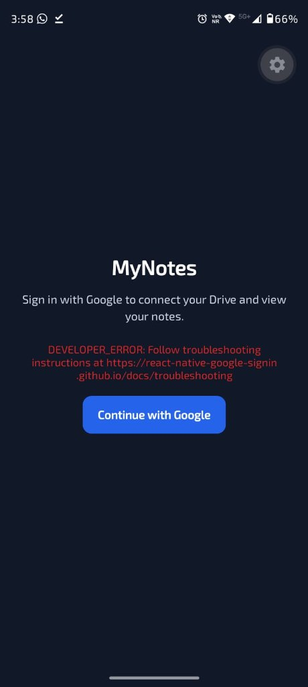
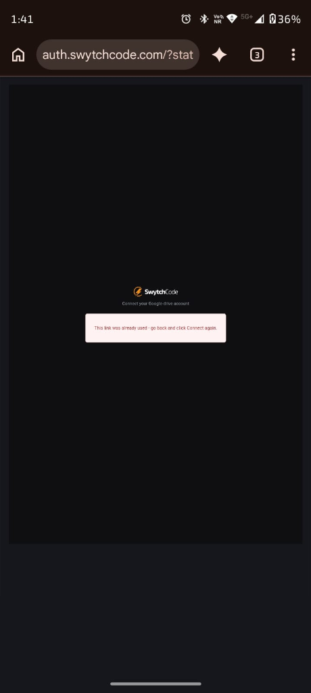
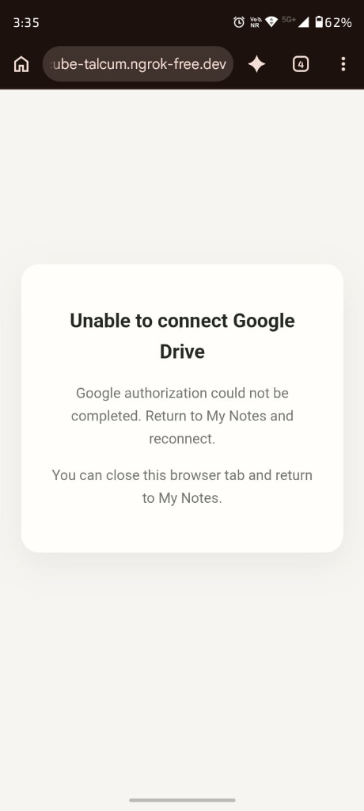

# Project Summary & Technical Report: My Notes App
**Target Role / Team:** SwytchCode PPI (Pre-Placement Interview)  
**Author:** Braj Mohan Singh  

---

## 1. Project Overview (In Short)

* **GitHub Repository:**  [https://github.com/brajmohan01/MyNotesMobileApp](https://github.com/brajmohan01/MyNotesMobileApp)
* **What it is:** **My Notes** is a secure, cross-platform mobile note-taking application (React Native / Expo SDK 58) backed by an Express 5 API running serverlessly on Vercel with Upstash Redis.
* **Core Functionality:** Enables authenticated users to browse, search, view, and edit rich HTML notes stored exclusively inside a dedicated `My Notes` folder on their personal Google Drive.
* **Zero-Trust Client Security:** 
  - Google OAuth tokens never reach the mobile device.
  - Refresh and access tokens are encrypted at rest on the backend using **AES-256-GCM**.
  - The mobile app communicates via lightweight, cryptographically signed session tokens.
  - HTML notes are sanitized on the backend using `sanitize-html` and `css-tree` (AST parser) and rendered in a sandboxed, script-disabled WebView (`javaScriptEnabled={false}`).

```
[Mobile App: Expo / React Native]
         │ (Session Token: HMAC-SHA256)
         ▼
[Backend: Express 5 on Vercel Serverless]
    ├── AES-256-GCM Tokens ──► [Upstash Redis Store]
    └── Direct API SDK      ──► [Google Drive API v3]
```

---

## 2. Where SwytchCode Was Used & Why It Failed

* **Role of SwytchCode in the Project:** 
  SwytchCode was integrated as an automated execution and authentication layer to connect the application to the Google Drive API without manually managing raw Google OAuth and Drive endpoints.
* **Why it didn't work for this application:**
  1. **Multi-Tenant End-User OAuth vs. Agent Tooling:** SwytchCode is optimized for developer/agent execution with pre-configured static credentials. A consumer mobile app requires dynamic, multi-tenant OAuth with PKCE, user consent prompts, and custom mobile deep links (`mynotesapp:///auth/callback`).
  2. **Raw Binary / Text Streaming (`alt=media`):** Reading HTML notes from Google Drive requires `drive.files.get({ alt: 'media' })`, which streams raw text/HTML instead of structured JSON. Generic agent tool proxies fail to process or serialize this stream reliably.
  3. **Stateless Serverless Deployment:** Deploying to Vercel requires stateless execution where tokens are stored in distributed Redis, rather than a persistent agent runtime or CLI daemon.

---

## 3. Analysis & Reproduction of Encountered Errors

### Error 1: Native Google Sign-In `DEVELOPER_ERROR`



* **Error Observed:** `DEVELOPER_ERROR: Follow troubleshooting instructions at https://react-native-google-signin.github.io/docs/troubleshooting`
* **Root Cause:**
  - Occurred when using native `@react-native-google-signin/google-signin` on Android.
  - Google Play Services returns `DEVELOPER_ERROR` (code 10) when the Android package name (`com.mynotesapp`) and the SHA-1 certificate fingerprint of the keystore (debug or release) do not match the Android OAuth 2.0 Client registered in Google Cloud Console.
* **Steps to Recreate:**
  1. Integrate `@react-native-google-signin/google-signin` into an Expo/React Native build.
  2. Trigger `GoogleSignin.signIn()` on an Android device where the app's build keystore SHA-1 has not been registered under Google Cloud Console > Credentials > Android Client ID.
* **Resolution:** Replaced client-side native Google Sign-In with backend-driven Web OAuth 2.0 with PKCE via `expo-web-browser` and a registered Web Application Client ID.

---

### Error 2: SwytchCode Auth Link Replay / Expiration



* **Error Observed:** `auth.swytchcode.com/?state=...` displays:  
  *"This link was already used - go back and click Connect again."*
* **Root Cause:**
  - SwytchCode's hosted OAuth bridge enforces single-use, short-lived state tokens.
  - When the mobile app opened the auth URL via `WebBrowser.openAuthSessionAsync`, the in-app browser triggered a page reload, or the redirect to the custom deep link (`mynotesapp:///...`) double-fired.
  - Because the state token had already been consumed on the first handshake, the second hit threw the single-use replay protection error.
* **Steps to Recreate:**
  1. Generate an auth URL pointing to `https://auth.swytchcode.com/?state=<state_token>`.
  2. Open the URL in an in-app browser or mobile Chrome.
  3. Refresh the page or trigger the same state parameter after the initial handshake has been initiated.
* **Resolution:** Switched to an in-house PKCE-protected authorization flow where the backend manages state generation, validation, and single-use handoff codes via Upstash Redis.

---

### Error 3: Backend Local Tunnel / OAuth Callback Failure



* **Error Observed:** `...ngrok-free.dev` displays:  
  *"Unable to connect Google Drive: Google authorization could not be completed. Return to My Notes and reconnect."*
* **Root Cause:**
  - Originates from `backend/src/routes/auth.js` (`callbackPage` handler).
  - While using an ngrok tunnel during local development:
    1. The backend restarted, wiping in-memory OAuth state (`oauthStates` map).
    2. Ngrok's free tier interstitial warning page ("You are about to visit...") delayed the callback past its TTL (10 minutes) or stripped query parameters.
    3. The Google Cloud Console redirect URI was mismatched with the newly generated ngrok subdomain.
* **Steps to Recreate:**
  1. Start the backend with an ngrok HTTPS tunnel as `GOOGLE_REDIRECT_URI`.
  2. Initiate sign-in from the mobile app to set the state in memory.
  3. Restart the backend process (clearing memory) before completing the Google consent screen, then click "Allow".
* **Resolution:** Migrated to durable Upstash Redis storage for OAuth state and deployed the backend with a permanent HTTPS domain on Vercel.

---

## 4. Commands to Build and Run the Project

### Prerequisites
* Node.js 24 and npm
* Expo CLI and EAS CLI (`npm install -g eas-cli`)
* Google Cloud Console Project with Google Drive API enabled and Web Application OAuth credentials

---

### Step 1: Install Dependencies
```bash
# Install mobile frontend dependencies
npm ci

# Install backend dependencies
npm --prefix backend ci
```

---

### Step 2: Configure Environment Variables

**Backend (`backend/.env`):**
```ini
PORT=3000
GOOGLE_CLIENT_ID="<your-google-web-client-id>"
GOOGLE_CLIENT_SECRET="<your-google-client-secret>"
GOOGLE_REDIRECT_URI="https://<your-backend-host>/api/auth/google/callback"
APP_REDIRECT_URI="mynotesapp:///auth/callback"
SESSION_SECRET="<32-byte-hex-string>"
GOOGLE_DRIVE_TOKEN_ENCRYPTION_KEY="<32-byte-base64-string>"
GOOGLE_DRIVE_TOKEN_STORE_PATH="./data/google-drive-tokens.json"

# For Vercel production deployment:
UPSTASH_REDIS_REST_URL="<upstash-redis-rest-url>"
UPSTASH_REDIS_REST_TOKEN="<upstash-redis-rest-token>"
```

**Mobile App (`.env`):**
```ini
EXPO_PUBLIC_API_URL="https://<your-backend-host>"
```

---

### Step 3: Run the Application Locally

```bash
# Terminal 1: Start Express backend
npm run server:dev

# Terminal 2: Start Expo mobile development server
npm start
```

---

### Step 4: Verify and Test the Codebase
```bash
# Run backend test suite (unit and integration tests)
npm run test:backend

# Run TypeScript type check
npm run typecheck

# Run linter
npm run lint
```

---

### Step 5: Build Installable Android APK

```bash
# Log in to EAS
npx eas-cli login

# Build standalone Android APK using production profile
npx eas-cli build --platform android --profile production
```
*(The generated APK will be output by EAS and can be installed directly onto any Android device).*
